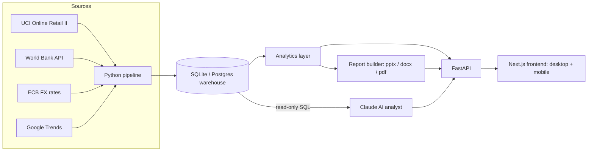

# MarketLens — Global Market Intelligence Platform

An end-to-end analytics platform for a D2C beauty brand selling in 18 countries. It answers the
questions international e-commerce teams actually ask: where revenue comes from, which markets are
growing or slipping, why customers churn or fail to convert, and which country to expand into next.

**Features**

- **Global overview** — interactive world map, KPIs with period-over-period change, revenue by region, conversion funnel, cohort retention, channel and category mix.
- **Markets** — sortable comparison of every market, with a detail panel per country (desktop side panel, mobile bottom sheet).
- **Expansion scoring** — a Market Attractiveness Score combining market size, digital adoption, search demand and affluence. Users adjust the weights or pick a strategy preset and the ranking updates live.
- **AI senior analyst** — ask questions in plain English. Claude writes SQL against a read-only warehouse, checks the numbers, and answers like a senior analyst (answer, evidence, drivers, next step) with a chart and the exact queries it ran.
- **One-click reports** — export PowerPoint, Word or PDF reports with branded layouts, charts, tables and an AI-written executive summary and recommendations.
- **Built for mobile** — bottom tab bar, filter sheet, card layouts and a thumb-friendly chat composer. Light and dark themes.

## Architecture



| Layer | Tech |
|---|---|
| Frontend | Next.js 14, TypeScript, Tailwind CSS, Recharts, react-simple-maps |
| Backend | FastAPI, SQLite (swap for Postgres/BigQuery), pandas |
| AI | Claude via the Anthropic API with tool use (text-to-SQL, charts) |
| Reports | python-pptx, python-docx, ReportLab, matplotlib |
| Pipeline | Python scripts for UCI Online Retail II, World Bank API, Frankfurter (ECB) FX |

## Run it locally

**1. Backend** (Python 3.11+)

```bash
cd backend
python -m venv .venv && source .venv/bin/activate   # Windows: .venv\Scripts\activate
pip install -r requirements.txt
cp .env.example .env            # add your ANTHROPIC_API_KEY for full AI answers
python pipeline/seed_demo.py    # builds data/marketlens.db (already included)
uvicorn app.main:app --reload   # http://localhost:8000/docs
```

**2. Frontend** (Node 18+)

```bash
cd frontend
npm install --legacy-peer-deps
cp .env.example .env.local      # NEXT_PUBLIC_API_URL=http://localhost:8000
npm run dev                     # http://localhost:3000
```

Or run both with Docker: `docker compose up` (create `backend/.env` first).

Without an API key the AI analyst runs in **demo mode** with pre-built analyses for growth,
retention, conversion and expansion questions. Without the backend at all, the frontend falls back
to a bundled data snapshot so you can deploy it alone as a portfolio demo (reports and chat need the API).

## Use real data

```bash
python pipeline/ingest_worldbank.py          # live population, GDP per capita, internet use
python pipeline/ingest_fx.py 2024-10-01 2026-09-30   # monthly ECB exchange rates
python pipeline/ingest_online_retail.py      # real transactions (download the .xlsx first, see script)
python pipeline/export_snapshot.py           # refresh the frontend's offline snapshot
```

## Deploy

- **Frontend:** Vercel (set `NEXT_PUBLIC_API_URL` to your API URL).
- **Backend:** Render, Railway or Fly.io using `backend/Dockerfile`. Set `ANTHROPIC_API_KEY` and `CORS_ORIGINS` to your frontend URL.

## How the AI analyst stays trustworthy

- Queries run on a read-only connection with `PRAGMA query_only`, a single-statement check, a keyword blocklist and a 200-row cap.
- The system prompt forbids quoting any number it hasn't queried, and requires comparisons against a baseline.
- Every answer shows the SQL it ran so the reader can verify it.

## Project structure

```
backend/
  app/main.py                 FastAPI app and CORS
  app/db.py                   connections, read-only guardrails, schema doc for the AI
  app/routers/                metrics, chat, reports endpoints
  app/services/analytics.py   every KPI, cohort, funnel and score
  app/services/ai_analyst.py  Claude tool-use loop + demo mode
  app/services/report_builder.py   PowerPoint, Word and PDF generation
  pipeline/                   data generation and ingestion scripts
frontend/
  app/                        pages: overview, markets, expansion, analyst, reports
  components/                 shell, map, charts, KPI strip, filters
  lib/                        API client with offline fallback, types, formatting
```

## Talking points for interviews

1. **Business framing** — each page maps to a decision: where to invest, what to fix, where to expand.
2. **Metric design** — period-over-period growth, repeat-order share, cohort retention, funnel step rates, a weighted attractiveness score.
3. **Data engineering** — external API ingestion, currency normalisation, an analytics layer shared by the dashboard, AI and reports.
4. **AI engineering** — tool use, guardrails, grounded answers with visible SQL.
5. **Product thinking** — mobile layouts, empty and error states, one-click exports for stakeholders.

Demo data is synthetic and generated by `pipeline/seed_demo.py`.
